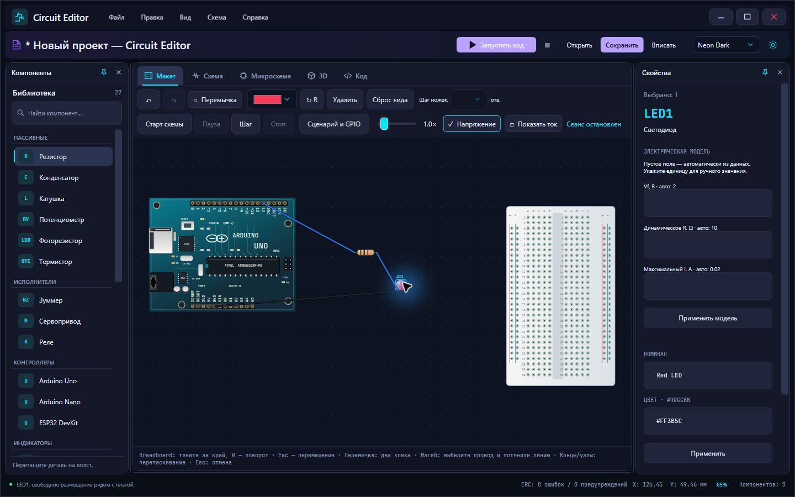
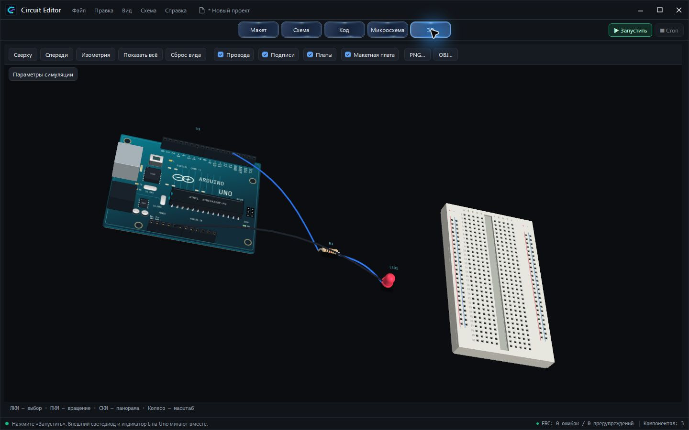
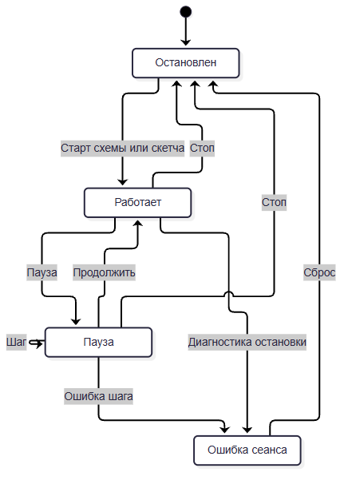
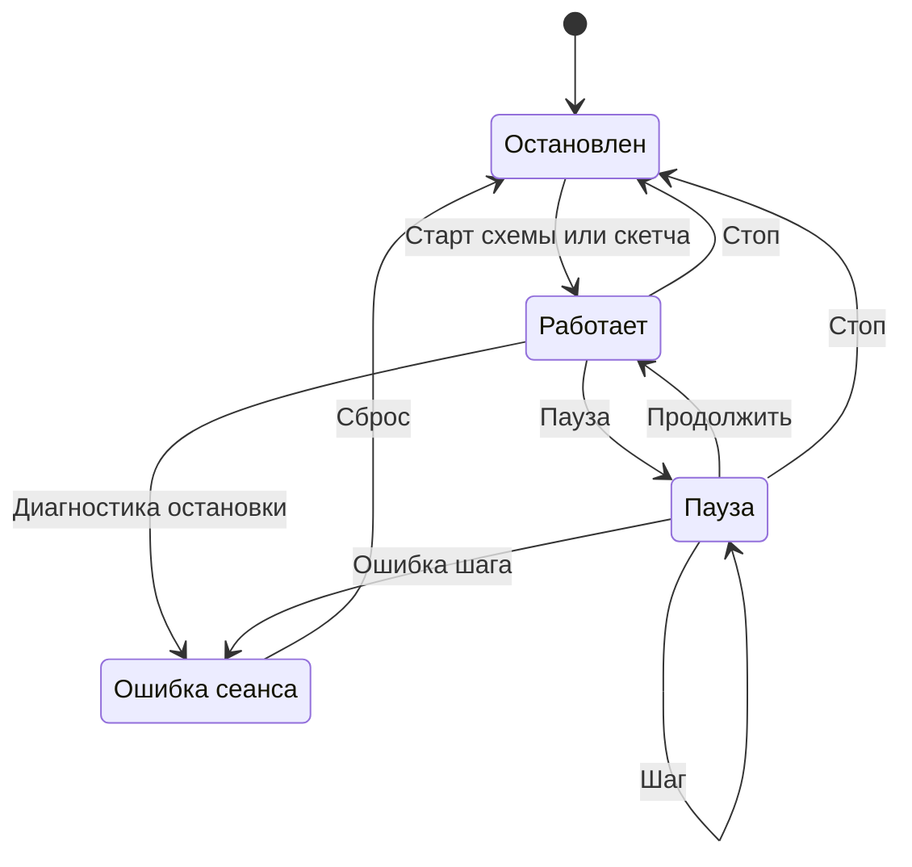

# Circuit Editor

Десктопный редактор электрических схем для Arduino Uno, Nano и ESP32 с учебной симуляцией и 3D-просмотром.

[](LICENSE)

| Макет Uno с внешним светодиодом | Условная схема того же проекта |
| --- | --- |
| [](docs/images/uno-mockup.jpg) | [](docs/images/uno-schematic.jpg) |
| **Изометрия макета** | **Шаблон 7400 в конструкторе микросхем** |
| [](docs/images/uno-3d.jpg) | [](docs/images/chip-7400.jpg) |

[Редактор Arduino с подсветкой скетча Blink](docs/images/uno-code.jpg)

## Что умеет

- Монтаж с breadboard, перемычками и 27 компонентами, включая Uno, Nano и ESP32.
- Условная схема с общей электрической моделью и независимым размещением символов.
- ERC, статический DC-расчёт и калькулятор номиналов.
- AvalonEdit с подсветкой Arduino, автодополнением, генерацией и анализом скетча.
- Учебное выполнение GPIO-скетчей, встроенные сценарии и ручное управление выводами.
- Мультиметр, осциллограф, логический анализатор и виртуальный Serial.
- Редактор цифровых DIP-микросхем с 12 шаблонами, таблицами, графами и испытательным стендом.
- Процедурный 3D с камерой, слоями и реакциями на сигналы симуляции.
- Проекты `.circ`, Undo/Redo, автовосстановление и экспорт PNG, SVG, OBJ, CSV и `.ino`.

## Установка

1. В разделе **Releases** скачайте `setup.exe` и пройдите мастер. При отсутствии .NET Desktop Runtime 8 x64 мастер предложит установить его офлайн.
2. Если SmartScreen показывает предупреждение, проверьте источник файла. Для доверенного файла выберите **Подробнее → Выполнить в любом случае**. Установщик приложения не подписан сертификатом.
3. Запустите Circuit Editor и выберите **Файл → Примеры → Uno · мигающий светодиод**. Нажмите **Старт схемы**. Для выполнения самого скетча сначала остановите сценарий, затем нажмите **Запустить код** или `Ctrl+Shift+B`.

**Переносимый вариант** — `CircuitEditor-win-x64.zip`. Распакуйте архив целиком и откройте `CircuitEditor.App.exe`. Среда .NET входит в архив.

Требуется Windows 10 x64 (1607 или новее) либо Windows 11 x64. Для работы с боковыми панелями и 3D рекомендованы экран 1920×1080, 8 ГБ ОЗУ и аппаратное ускорение WPF. Предусмотрите около 500 МБ для распаковки и рабочих файлов.

### Сборка из исходников

Используйте .NET 8 SDK, указанный в [global.json](global.json), и запустите команды из корня решения.

```powershell
dotnet build CircuitEditor.sln
dotnet run --project CircuitEditor.App
```

Команды сборки установщика и ZIP, порядок загрузки в GitHub Releases описаны в [RELEASE.md](RELEASE.md).

## Архитектура

- **App** принимает команды WPF, связывает представления и ViewModel через DI.
- **Core** хранит общую электрическую модель, два размещения, историю и форматы документов.
- **Core** строит netlist, проверяет ERC, рассчитывает DC и формирует секции скетча.
- **Simulation** работает со снимком проекта на виртуальных часах и публикует сигналы для UI.
- **Infrastructure** читает каталоги и выполняет миграции и файловые операции через репозитории.
- **Tests** проверяет эти слои и раскладку настоящего WPF-интерфейса.

[Архитектура и потоки данных](docs/architecture.md)

[](docs/uml/generated/00-projects.mmd)

## Диаграммы

| Диаграмма | Что показывает |
| --- | --- |
| [](docs/uml/generated/00-projects.mmd) | **Зависимости проектов** — связи `ProjectReference` пяти проектов. |
| [](docs/uml/generated/01-project-model.mmd) | **Ядро модели** — проект, компоненты, контакты, размещения и электрические узлы. |
| [](docs/uml/sequence-simulation.mmd) | **Шаг симуляции** — от виртуальных часов до снимка состояния для интерфейса. |
| [](docs/uml/use-cases.mmd) | **Варианты использования** — действия от монтажа и проверки до симуляции и экспорта. |
| [](docs/uml/state-simulation.mmd) | **Состояния сеанса** — запуск, пауза, шаг, остановка и ошибка. |

<details>
<summary>Состояния симуляции в Mermaid</summary>



</details>

[Полное оглавление, превью и регенерация UML](docs/uml/README.md)

## Стек и структура решения

C# 12, .NET 8, WPF, CommunityToolkit.Mvvm, Microsoft.Extensions.DependencyInjection, AvalonEdit, HelixToolkit.Wpf, System.Text.Json и xUnit.

| Путь | Назначение |
| --- | --- |
| [CircuitEditor.App](CircuitEditor.App/CircuitEditor.App.csproj) | WPF, ViewModel, темы и регистрация зависимостей |
| [CircuitEditor.Core](CircuitEditor.Core/CircuitEditor.Core.csproj) | Электрическая модель, проверки, расчёты и генерация кода |
| [CircuitEditor.Infrastructure](CircuitEditor.Infrastructure/CircuitEditor.Infrastructure.csproj) | Каталоги, репозитории и миграции |
| [CircuitEditor.Simulation](CircuitEditor.Simulation/CircuitEditor.Simulation.csproj) | События, GPIO, сценарии, поведения и приборы |
| [CircuitEditor.Tests](CircuitEditor.Tests/CircuitEditor.Tests.csproj) | Автоматические проверки |
| [Samples](Samples/index.json) | Пять учебных проектов |
| [tools/UmlGenerator](tools/UmlGenerator/UmlGenerator.csproj) | Отдельный генератор Mermaid по исходникам |

## Тесты

Последний Release-прогон — **533 из 533 тестов**, сборка без ошибок и предупреждений.

```powershell
dotnet test CircuitEditor.sln -c Release
```

[Покрытие тестов и проверка диаграмм](docs/testing.md)

## Ограничения

Учебный запуск охватывает только поддерживаемое подмножество Arduino. Аналоговая динамика RC/LC и точное моделирование аппаратных протоколов отсутствуют. В проекте одна breadboard, 3D служит для просмотра и экспорта. Конструктор рассчитан на цифровые DIP без C#-скриптов. [Полный список ограничений](docs/limitations.md)

## Документация

- [Руководство пользователя и пять примеров](docs/user-guide.md)
- [Архитектура](docs/architecture.md) и [UML](docs/uml/README.md)
- [Форматы .circ и .chip](docs/file-formats.md)
- [Модель симуляции](docs/simulation-model.md) и [производительность](docs/stage-10-performance.md)
- [Электрические расчёты](docs/stage5.md), [редактор кода](docs/stage6-code-editor.md) и [конструктор DIP](docs/stage-8-chips.md)
- [Сценарий защиты и вопросы комиссии](docs/defense.md)
- [Подготовка архива](RELEASE.md), [описание релиза v1.0](docs/release-notes.md) и [итоговый аудит](docs/stage-10-audit.md)

## Лицензия

Copyright © 2026 Abduseliov Ismail. [MIT](LICENSE) · [Лицензии зависимостей](THIRD-PARTY-NOTICES.md)
