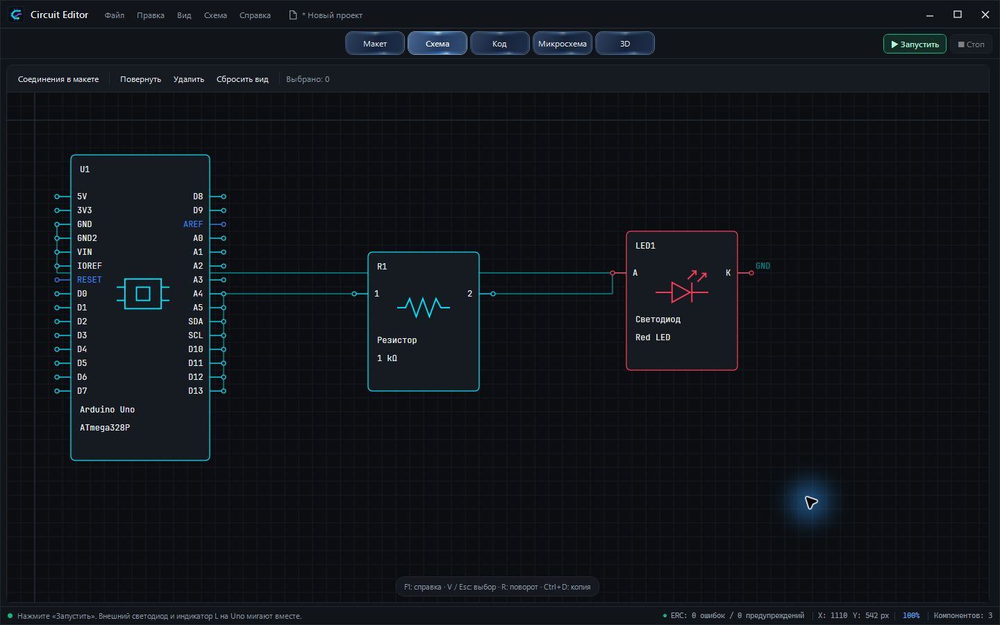
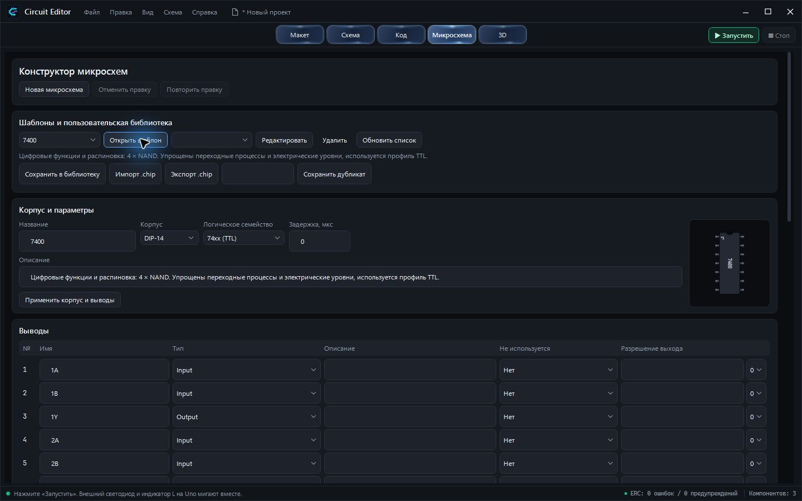
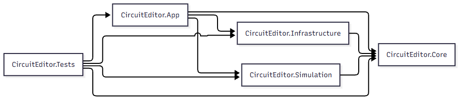
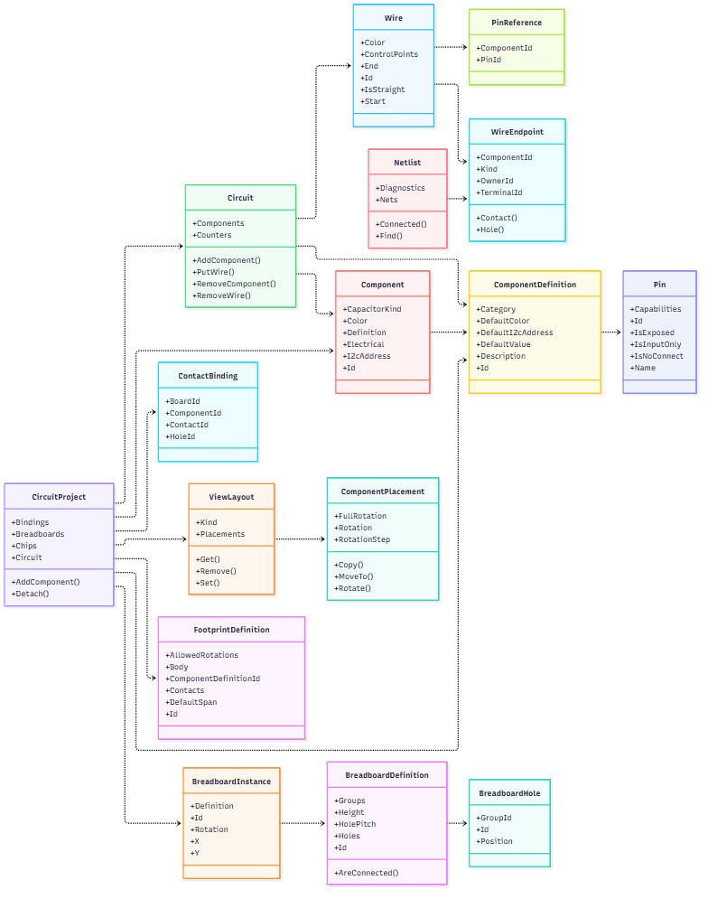
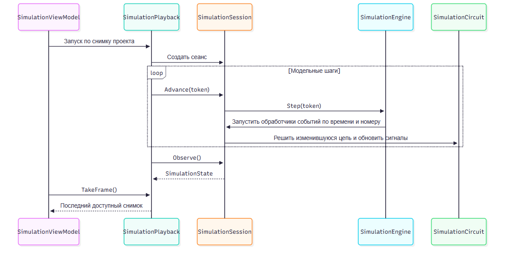
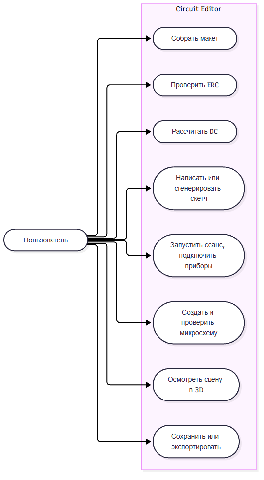
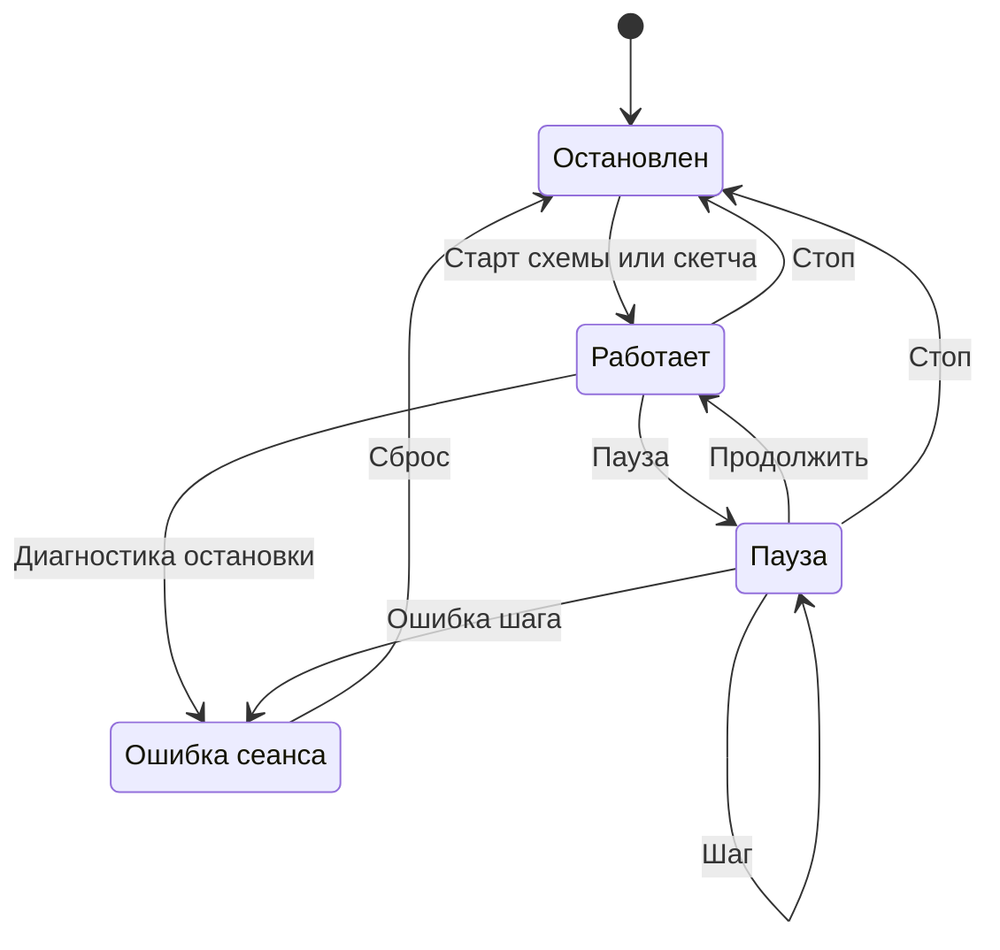

<p align="center">
  
</p>


# Circuit Editor

Десктопный редактор электрических схем для Arduino Uno, Nano и ESP32 с учебной симуляцией. Версия **1.0.0**.

[](LICENSE)

| Макет Uno с внешним светодиодом | Условная схема того же проекта |
| --- | --- |
| [](docs/images/uno-mockup.jpg) | [](docs/images/uno-schematic.jpg) |

| 3D-вид макета | Конструктор 7400 |
| --- | --- |
| [](docs/images/uno-3d.jpg) | [](docs/images/chip-7400.jpg) |

[Редактор Arduino с подсветкой скетча Blink](docs/images/uno-code.jpg) · [Симуляция Blink](docs/images/uno-running.png) · [Учебные примеры](docs/images/samples-menu.png)

[Два дисплея в одном скетче](docs/images/dual-lcd.png) · [Разветвитель](docs/images/splitter-outputs.png) · [Редактирование горячих клавиш](docs/images/shortcut-edit.png) · [Встроенное руководство](docs/images/about-guide.png) · [Заставка](docs/images/startup-aurora.png)

## Что умеет

- Монтаж с макетной платой, прямыми или плавными перемычками и 28 штатными компонентами. В фотопалитре есть поиск, а при установке подсвечиваются отверстия под выводы. Разветвитель соединяет 2–8 выходов общей шиной.
- Условная схема с общей электрической моделью и независимым размещением символов.
- ERC, статический DC-расчёт и калькулятор номиналов.
- AvalonEdit с подсветкой Arduino, автодополнением, поиском, дублированием и перемещением строк. Горячие клавиши можно переназначать.
- Учебное выполнение скетчей, встроенные сценарии и ручное управление выводами. Скетч может обращаться к нескольким поддерживаемым дисплеям и другим устройствам по их адресу или контактам.
- Мультиметр, осциллограф, логический анализатор и виртуальный Serial.
- Редактор цифровых DIP-микросхем с 12 шаблонами, таблицами, графами и испытательным стендом.
- Подписи и линейка на макете, подсветка электрического узла, справка с уроками и девять готовых проектов.
- Просмотр макета в 3D с вращением камеры, слоями, объёмными гнёздами и выводами компонентов.
- Проекты `.circ`, Undo/Redo, автовосстановление и экспорт PNG, OBJ (3D), SVG, CSV и `.ino`.

## Установка

1. В разделе **Releases** скачайте `setup.exe` и пройдите мастер. При отсутствии .NET Desktop Runtime 8 x64 мастер предложит установить его офлайн.
2. Если SmartScreen показывает предупреждение, проверьте источник файла. Для доверенного файла выберите **Подробнее → Выполнить в любом случае**. Установщик приложения не подписан сертификатом.
3. Запустите Circuit Editor и выберите **Справка → Учебные примеры → Uno · мигающий светодиод**. Откройте **Код**, чтобы увидеть `setup()` и `loop()`. Нажмите **Запустить**. Чтобы проверить готовый сценарий отдельно, остановите код и выберите **Макет → Параметры симуляции → Старт схемы**.

Обзор пяти вкладок и порядок работы с первым проектом доступны в **Справка → О приложении**. Настройки клавиш находятся в **Справка → Горячие клавиши**. Дважды щёлкните по текущему сочетанию в нужной строке и нажмите новые клавиши.

**Переносимый вариант** — `CircuitEditor-win-x64.zip`. Распакуйте архив целиком и откройте `CircuitEditor.App.exe`. Среда .NET входит в архив.

Требуется Windows 10 x64 (1607 или новее) либо Windows 11 x64. Для работы с открытой фотопалитрой и диагностикой рекомендованы экран 1920×1080, 8 ГБ ОЗУ и аппаратное ускорение WPF. Предусмотрите около 500 МБ для распаковки и рабочих файлов.

### Сборка из исходников

Используйте .NET 8 SDK, указанный в [global.json](global.json), и запустите команды из корня решения.

```powershell
dotnet build CircuitEditor.sln
dotnet run --project CircuitEditor.App
```

Команды сборки установщика и ZIP, порядок загрузки в GitHub Releases описаны в [RELEASE.md](RELEASE.md).

## Архитектура

- **App** принимает команды WPF, связывает представления и ViewModel через DI.
- **Core** хранит общую электрическую модель, два размещения, историю и форматы документов.
- **Core** строит netlist, проверяет ERC, рассчитывает DC и формирует секции скетча.
- **Simulation** работает со снимком проекта на виртуальных часах и публикует сигналы для UI.
- **Infrastructure** читает каталоги и выполняет миграции и файловые операции через репозитории.
- **Tests** проверяет эти слои и раскладку настоящего WPF-интерфейса.

[Архитектура и потоки данных](docs/architecture.md)

[](docs/uml/generated/00-projects.mmd)

## Диаграммы

| Диаграмма | Что показывает |
| --- | --- |
| [](docs/uml/generated/00-projects.mmd) | **Зависимости проектов** — связи `ProjectReference` пяти проектов. |
| [](docs/uml/generated/01-project-model.mmd) | **Ядро модели** — проект, компоненты, контакты, размещения и электрические узлы. |
| [](docs/uml/sequence-simulation.mmd) | **Шаг симуляции** — от виртуальных часов до снимка состояния для интерфейса. |
| [](docs/uml/use-cases.mmd) | **Варианты использования** — действия от монтажа и проверки до симуляции и экспорта. |
| [](docs/uml/state-simulation.mmd) | **Состояния сеанса** — запуск, пауза, шаг, остановка и ошибка. |

<details>
<summary>Состояния симуляции в Mermaid</summary>



</details>

[Полное оглавление, превью и регенерация UML](docs/uml/README.md)

## Стек и структура решения

C# 12, .NET 8, WPF, CommunityToolkit.Mvvm, Microsoft.Extensions.DependencyInjection, AvalonEdit, System.Text.Json и xUnit.

| Путь | Назначение |
| --- | --- |
| [CircuitEditor.App](CircuitEditor.App/CircuitEditor.App.csproj) | WPF, ViewModel, темы и регистрация зависимостей |
| [CircuitEditor.Core](CircuitEditor.Core/CircuitEditor.Core.csproj) | Электрическая модель, проверки, расчёты и анализ скетчей |
| [CircuitEditor.Infrastructure](CircuitEditor.Infrastructure/CircuitEditor.Infrastructure.csproj) | Каталоги, репозитории и миграции |
| [CircuitEditor.Simulation](CircuitEditor.Simulation/CircuitEditor.Simulation.csproj) | События, GPIO, сценарии, поведения и приборы |
| [CircuitEditor.Tests](CircuitEditor.Tests/CircuitEditor.Tests.csproj) | Автоматические проверки |
| [Samples](Samples/index.json) | Девять учебных проектов |
| [tools/UmlGenerator](tools/UmlGenerator/UmlGenerator.csproj) | Отдельный генератор Mermaid по исходникам |

## Тесты

Последняя Release-проверка — **588 из 588 тестов** в каждом из трёх прогонов. Сборка завершилась без ошибок и предупреждений.

```powershell
dotnet test CircuitEditor.sln -c Release
```

[Покрытие тестов и проверка диаграмм](docs/testing.md)

## Ограничения

Учебный запуск охватывает только поддерживаемое подмножество Arduino. Аналоговая динамика RC/LC и точное моделирование аппаратных протоколов отсутствуют. В проекте одна breadboard. Конструктор рассчитан на цифровые DIP без C#-скриптов. [Полный список ограничений](docs/limitations.md)

## Документация

- [Руководство для начинающих и девять примеров](docs/user-guide.md)
- [Архитектура](docs/architecture.md), [UML](docs/uml/README.md) и [фирменный стиль](docs/branding.md)
- [Форматы .circ и .chip](docs/file-formats.md)
- [Модель симуляции](docs/simulation-model.md) и [производительность](docs/stage-10-performance.md)
- [Электрические расчёты](docs/stage5.md), [редактор кода](docs/stage6-code-editor.md) и [конструктор DIP](docs/stage-8-chips.md)
- [Сценарий защиты и вопросы комиссии](docs/defense.md)
- [Подготовка архива](RELEASE.md), [описание релиза v1.0](docs/release-notes.md) и [итоговый аудит](docs/stage-10-audit.md)

## Лицензия

Copyright © 2026 Abduselimov Ismail. Проект и оригинальный логотип распространяются по [MIT](LICENSE) · [Лицензии зависимостей](THIRD-PARTY-NOTICES.md)
