# UML и диаграммы работы

Классы читаются из C# через Roslyn, зависимости — из ProjectReference в .csproj. Отдельный генератор не входит в CircuitEditor.sln. Частичные классы объединяются, в одной диаграмме не более 20 типов. Отображаются имена основных публичных членов и связи, обнаруженные по декларациям. Генерация не разворачивает тело методов, XAML-привязки, код генераторов и связи с типами на соседних страницах. Сценарии и переходы состояний сверены по реализации и поддерживаются отдельно.

| Диаграмма | Содержание | Превью и экспорт |
|---|---|---|
| [activity-chip](activity-chip.mmd) | Выбор корпуса, поведение, проверка и установка микросхемы. | [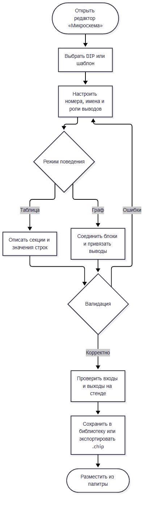](images/activity-chip.svg) · [PNG](images/activity-chip.png) |
| [sequence-erc](sequence-erc.mmd) | От изменения проекта и netlist до списка диагностик. | [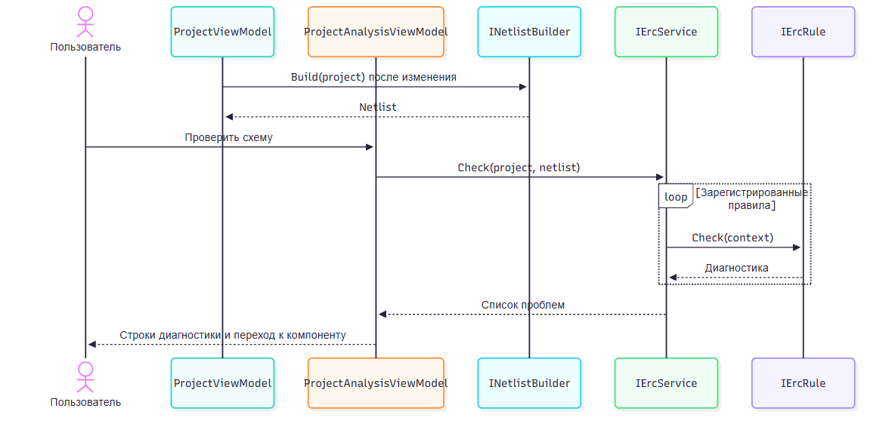](images/sequence-erc.svg) · [PNG](images/sequence-erc.png) |
| [sequence-open](sequence-open.mmd) | Чтение .circ, миграции и проверка перед заменой проекта. | [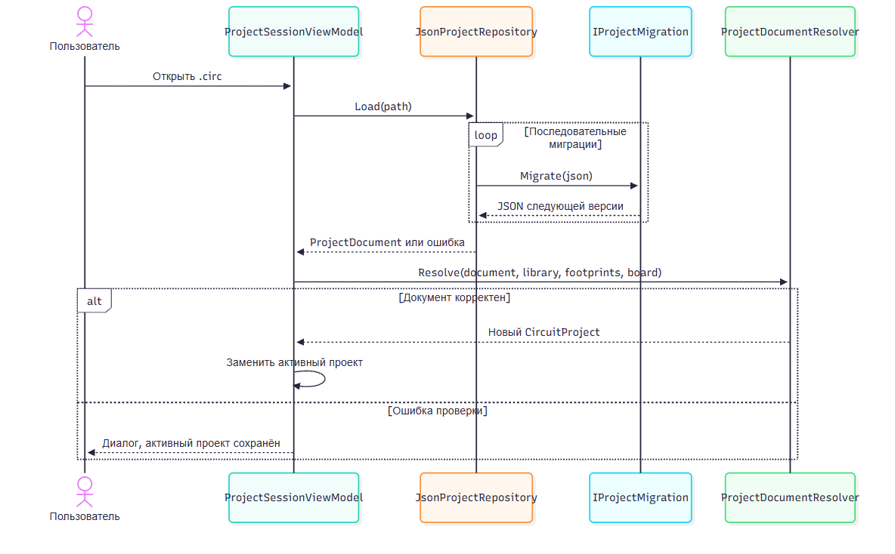](images/sequence-open.svg) · [PNG](images/sequence-open.png) |
| [sequence-simulation](sequence-simulation.mmd) | Виртуальные часы, шаг и публикация снимка. | [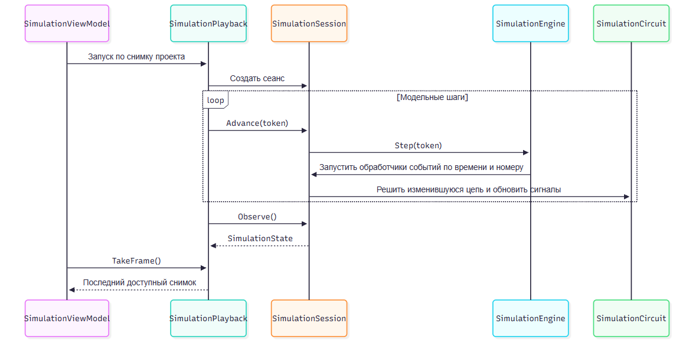](images/sequence-simulation.svg) · [PNG](images/sequence-simulation.png) |
| [sequence-sketch](sequence-sketch.mmd) | Редактирование скетча, отложенный анализ и переход к диагностике. | [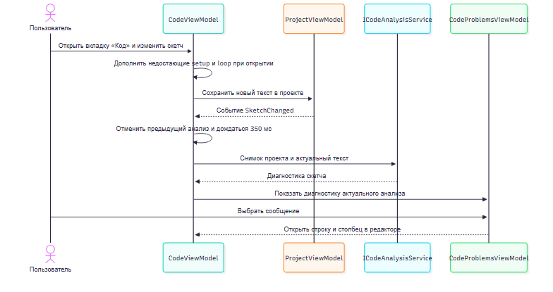](images/sequence-sketch.svg) · [PNG](images/sequence-sketch.png) |
| [state-simulation](state-simulation.mmd) | Запуск, пауза, шаг, сброс и ошибка сеанса. | [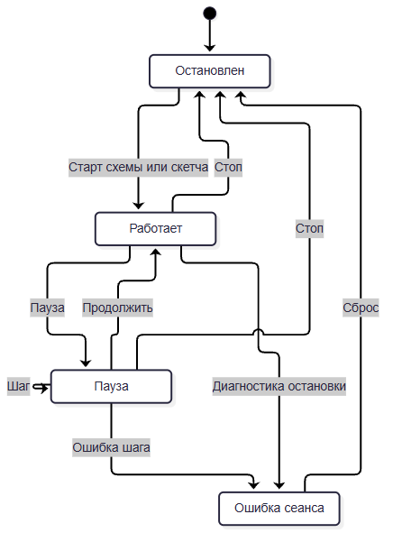](images/state-simulation.svg) · [PNG](images/state-simulation.png) |
| [use-cases](use-cases.mmd) | Действия пользователя от монтажа до экспорта. | [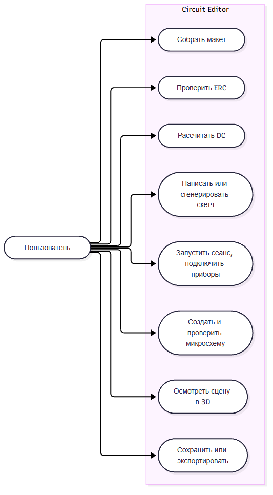](images/use-cases.svg) · [PNG](images/use-cases.png) |
| [00-projects](generated/00-projects.mmd) | Проекты и реальные ссылки ProjectReference. | [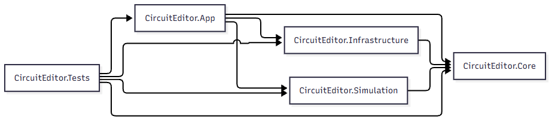](images/00-projects.svg) · [PNG](images/00-projects.png) |
| [01-project-model](generated/01-project-model.mmd) | CircuitProject, компоненты, размещения, breadboard и электрические узлы. | [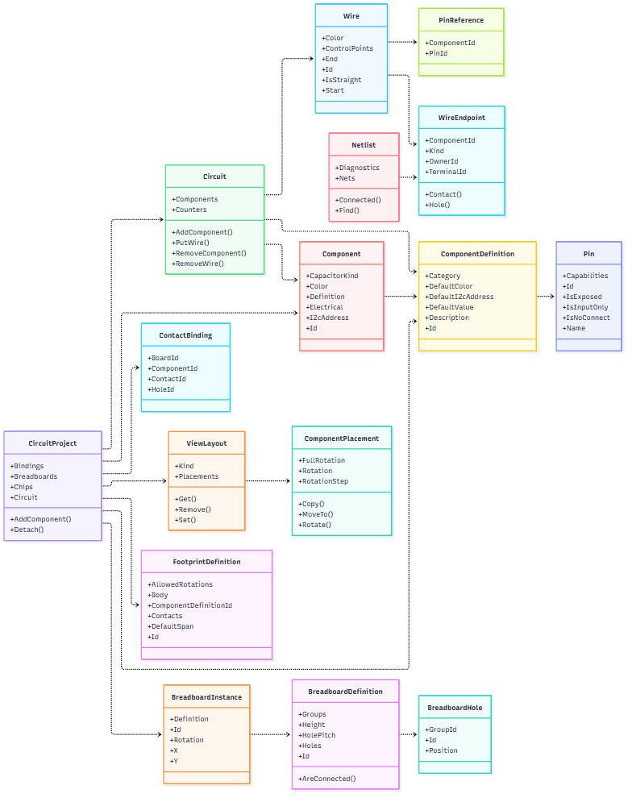](images/01-project-model.svg) · [PNG](images/01-project-model.png) |
| [3d-app-01](generated/3d-app-01.mmd) | 20 типов: BoardMeshes, ControllerMeshes, DeviceMeshes, DisplayMeshes и другие. | [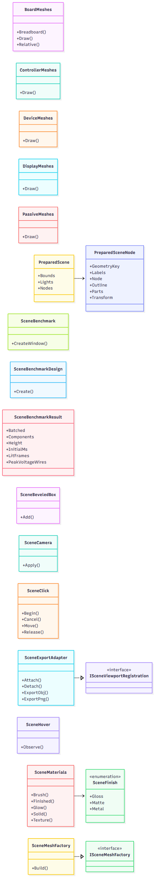](images/3d-app-01.svg) · [PNG](images/3d-app-01.png) |
| [3d-app-02](generated/3d-app-02.mmd) | Типов 17. SceneMeshPart, SceneMeshes, SceneObj, ScenePicking и другие. | [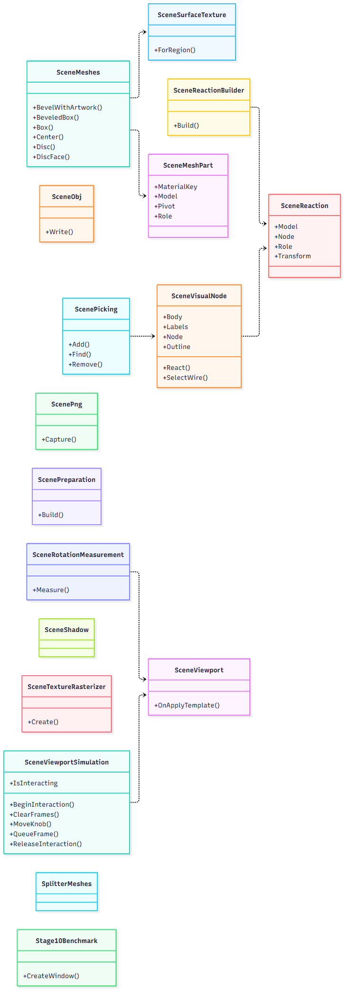](images/3d-app-02.svg) · [PNG](images/3d-app-02.png) |
| [3d-core-01](generated/3d-core-01.mmd) | Типов 19. ISceneBuilder, SceneBounds, SceneBuilder, SceneCatalog и другие. | [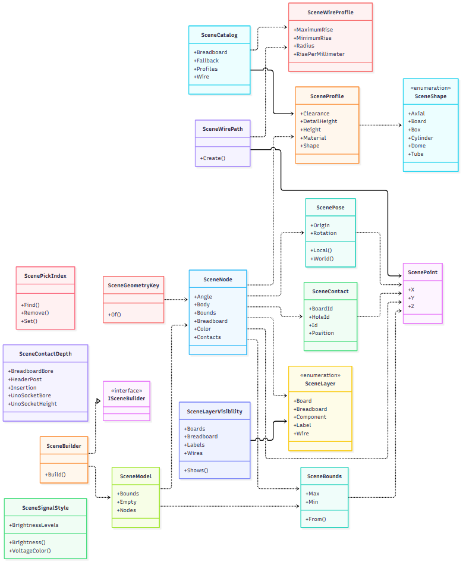](images/3d-core-01.svg) · [PNG](images/3d-core-01.png) |
| [calculations-core-01](generated/calculations-core-01.mmd) | 20 типов: BandResistance, CalculationResult, ComponentElectricalState, DcAssembly и другие. | [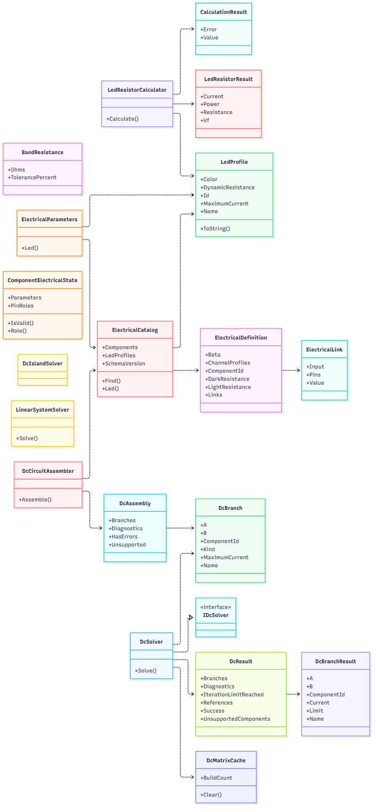](images/calculations-core-01.svg) · [PNG](images/calculations-core-01.png) |
| [calculations-core-02](generated/calculations-core-02.mmd) | 6 типов: OhmCalculator, OhmValues, PowerSource, PowerSourceDefinition и другие. | [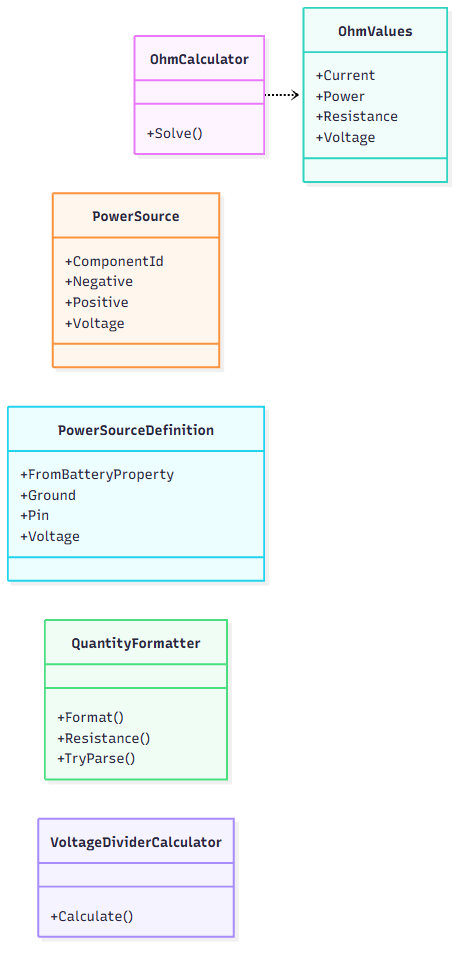](images/calculations-core-02.svg) · [PNG](images/calculations-core-02.png) |
| [chips-core-01](generated/chips-core-01.mmd) | 20 типов: ChipBehaviorDefinition, ChipContent, ChipDefinition, ChipEvaluation и другие. | [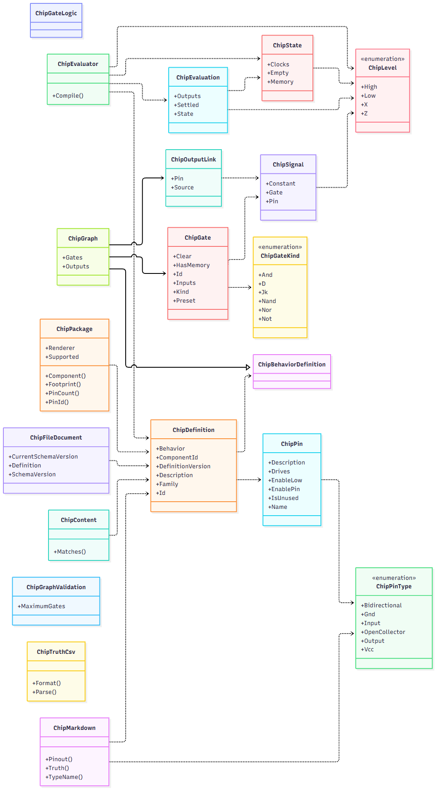](images/chips-core-01.svg) · [PNG](images/chips-core-01.png) |
| [chips-core-02](generated/chips-core-02.mmd) | 7 типов: ChipTruthLogic, ChipTruthSection, ChipTruthTable, ChipValidator и другие. | [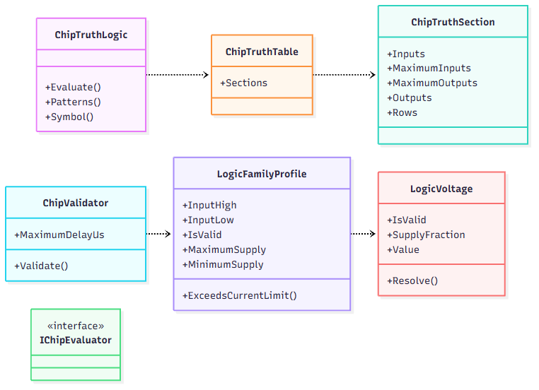](images/chips-core-02.svg) · [PNG](images/chips-core-02.png) |
| [code-core-01](generated/code-core-01.mmd) | 20 типов: ArduinoCodeAnalyzer, ArduinoCodeGenerator, AutoRegionInitializer, AutoRegionUpdater и другие. | [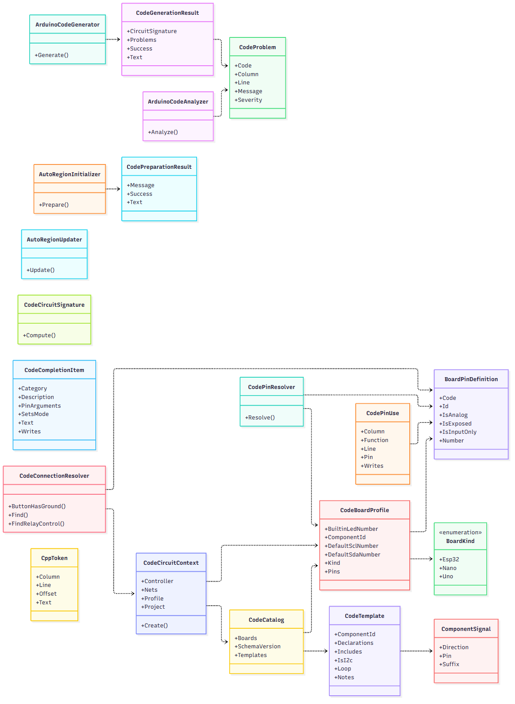](images/code-core-01.svg) · [PNG](images/code-core-01.png) |
| [code-core-02](generated/code-core-02.mmd) | Типов 7. CppTokenScanner, ICodeAnalyzer, ICodeGenerator, PinUsageCollector и другие. | [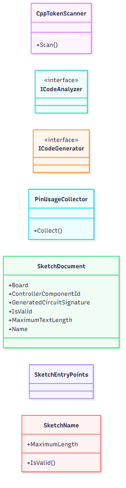](images/code-core-02.svg) · [PNG](images/code-core-02.png) |
| [model-core-01](generated/model-core-01.mmd) | 20 типов: BreadboardDefinition, BreadboardGeometry, BreadboardHole, BreadboardInstance и другие. | [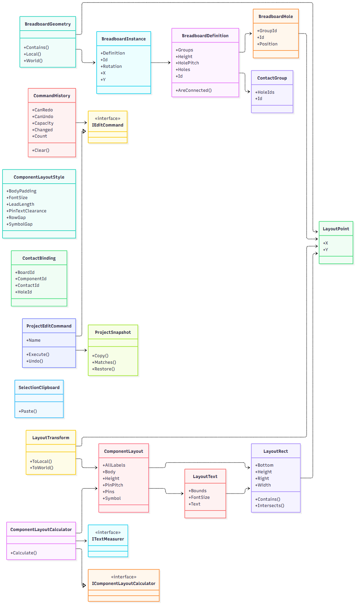](images/model-core-01.svg) · [PNG](images/model-core-01.png) |
| [model-core-02](generated/model-core-02.mmd) | Типов 20. PinLayout, SchematicPinGeometry, TextExtent, CapacitorKind и другие. | [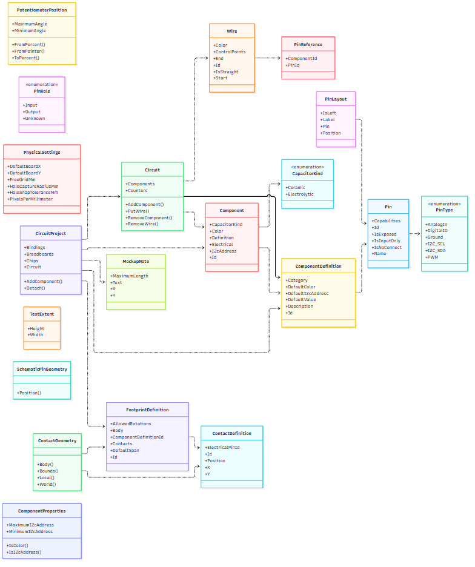](images/model-core-02.svg) · [PNG](images/model-core-02.png) |
| [model-core-03](generated/model-core-03.mmd) | Типов 11. ResistorMarking, RotaryControlDefinition, SplitterGeometry, ComponentPlacement и другие. | [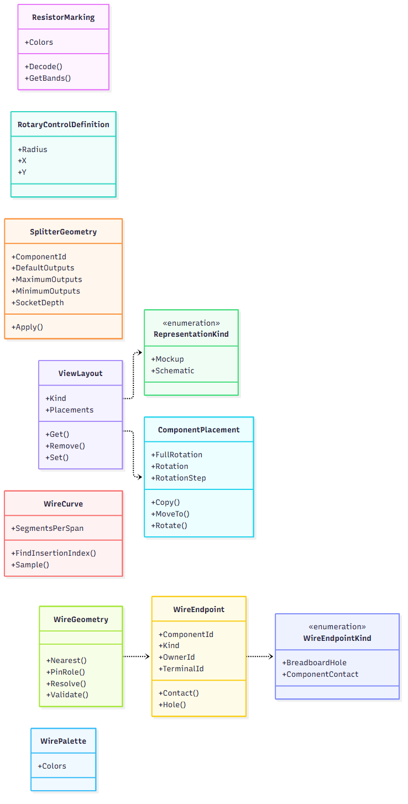](images/model-core-03.svg) · [PNG](images/model-core-03.png) |
| [netlist-erc-core-01](generated/netlist-erc-core-01.mmd) | 20 типов: INetlistBuilder, Net, NetTerminal, Netlist и другие. | [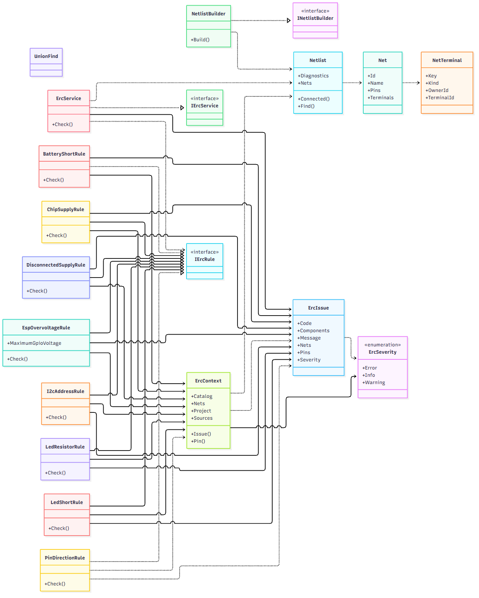](images/netlist-erc-core-01.svg) · [PNG](images/netlist-erc-core-01.png) |
| [netlist-erc-core-02](generated/netlist-erc-core-02.mmd) | 3 типов: RequiredPinRule, SourceConflictRule, SupplyShortRule | [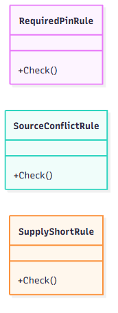](images/netlist-erc-core-02.svg) · [PNG](images/netlist-erc-core-02.png) |
| [repositories-formats-core-01](generated/repositories-formats-core-01.mmd) | 20 типов: BreadboardData, ComponentData, IProjectMigration, ProjectChipDefinitions и другие. | [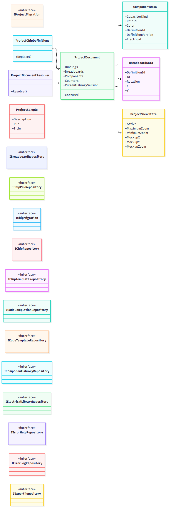](images/repositories-formats-core-01.svg) · [PNG](images/repositories-formats-core-01.png) |
| [repositories-formats-core-02](generated/repositories-formats-core-02.mmd) | Типов 14. IFootprintRepository, IGuideRepository, IInstallationLicenseRepository, ILogicFamilyRepository и другие. | [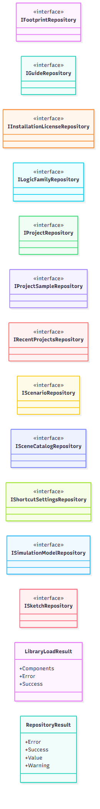](images/repositories-formats-core-02.svg) · [PNG](images/repositories-formats-core-02.png) |
| [repositories-formats-infrastructure-01](generated/repositories-formats-infrastructure-01.mmd) | 20 типов: BreadboardData, ColumnData, FootprintCatalogData, RailData и другие. | [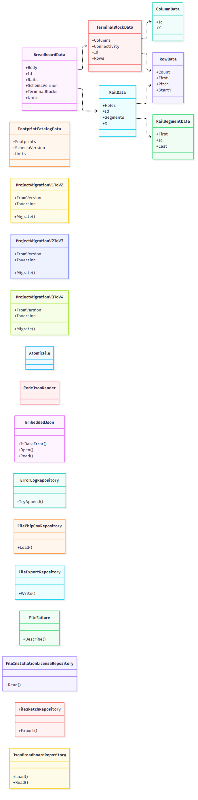](images/repositories-formats-infrastructure-01.svg) · [PNG](images/repositories-formats-infrastructure-01.png) |
| [repositories-formats-infrastructure-02](generated/repositories-formats-infrastructure-02.mmd) | Типов 17. JsonChipRepository, JsonChipTemplateRepository, JsonCodeCompletionRepository, JsonCodeTemplateRepository и другие. | [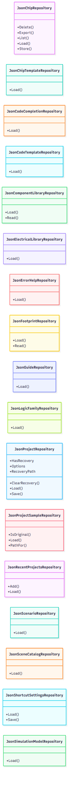](images/repositories-formats-infrastructure-02.svg) · [PNG](images/repositories-formats-infrastructure-02.png) |
| [simulation-core-01](generated/simulation-core-01.mmd) | 15 типов: ComponentSignal, InstrumentKind, InstrumentLayout, InstrumentSignal и другие. | [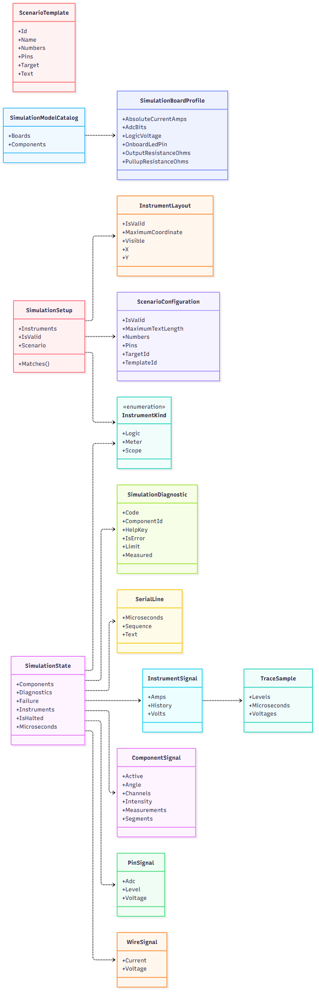](images/simulation-core-01.svg) · [PNG](images/simulation-core-01.png) |
| [simulation-simulation-01](generated/simulation-simulation-01.mmd) | Типов 20. BehaviorContext, ButtonBehavior, BuzzerBehavior, ChipBehavior и другие. | [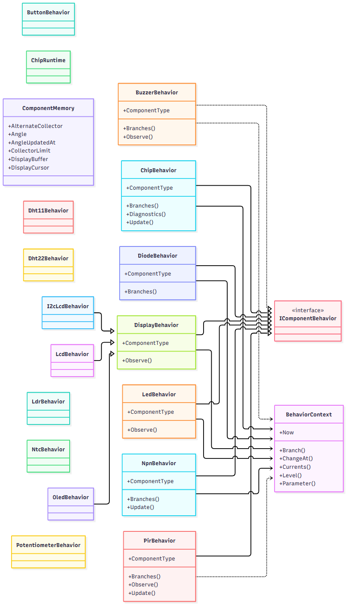](images/simulation-simulation-01.svg) · [PNG](images/simulation-simulation-01.png) |
| [simulation-simulation-02](generated/simulation-simulation-02.mmd) | 20 типов: RelayBehavior, RgbLedBehavior, SensorBehavior, ServoBehavior и другие. | [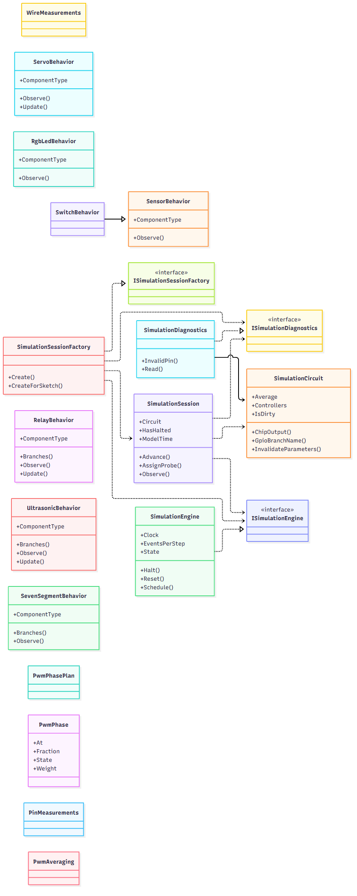](images/simulation-simulation-02.svg) · [PNG](images/simulation-simulation-02.png) |
| [simulation-simulation-03](generated/simulation-simulation-03.mmd) | Типов 20. DigitalLevel, GpioController, GpioMode, GpioState и другие. | [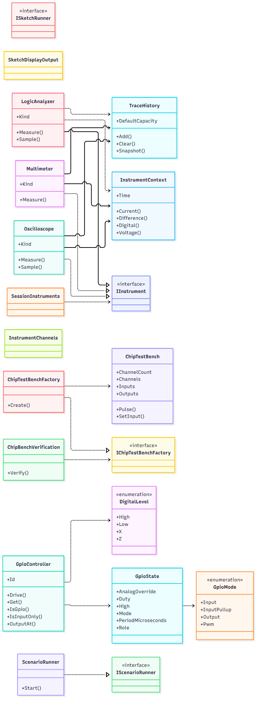](images/simulation-simulation-03.svg) · [PNG](images/simulation-simulation-03.png) |
| [simulation-simulation-04](generated/simulation-simulation-04.mmd) | Типов 16. SketchDisplayParser, SketchExecution, SketchExpression, SketchExpressionKind и другие. | [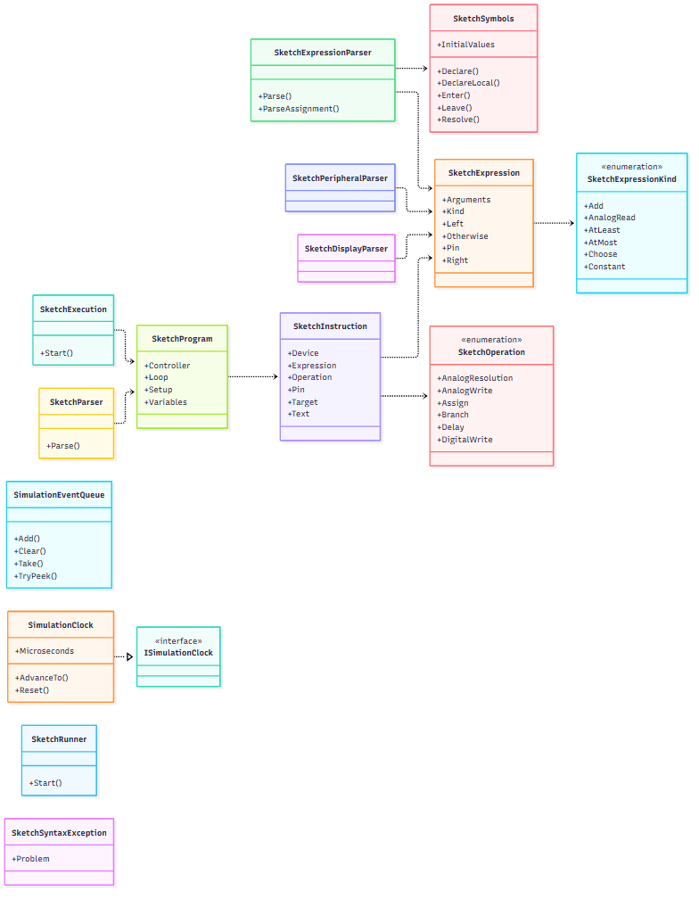](images/simulation-simulation-04.svg) · [PNG](images/simulation-simulation-04.png) |
| [support-app-01](generated/support-app-01.mmd) | Типов 20. App, PaneLimitConverter, PaneSizeConverter, ToolbarLabelVisibilityConverter и другие. | [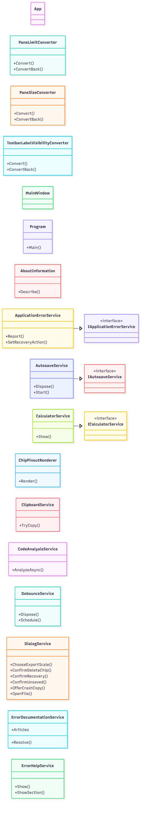](images/support-app-01.svg) · [PNG](images/support-app-01.png) |
| [support-app-02](generated/support-app-02.mmd) | Типов 20. IChipPinoutRenderer, IClipboardService, ICodeAnalysisService, IDebounceService и другие. | [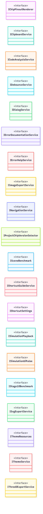](images/support-app-02.svg) · [PNG](images/support-app-02.png) |
| [support-app-03](generated/support-app-03.mmd) | Типов 19. IUserChipLibraryService, IWindowService, ImageExportService, NavigationService и другие. | [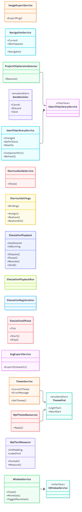](images/support-app-03.svg) · [PNG](images/support-app-03.png) |
| [support-core-01](generated/support-core-01.mmd) | Типов 19. DiagnosticArticle, GuideBoard, GuideChapter, GuideLibrary и другие. | [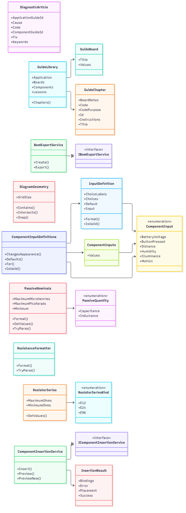](images/support-core-01.svg) · [PNG](images/support-core-01.png) |
| [tests-tests-01](generated/tests-tests-01.mmd) | Типов 20. AnalysisViewModelTests, BatchAFootprintTests, BatchAPresentationChecks, BatchBFootprintTests и другие. | [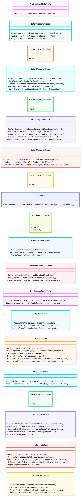](images/tests-tests-01.svg) · [PNG](images/tests-tests-01.png) |
| [tests-tests-02](generated/tests-tests-02.mmd) | Типов 20. CircuitModelTests, CodeAnalyzerTests, CodeEditorPresentationChecks, CodeGeneratorTests и другие. | [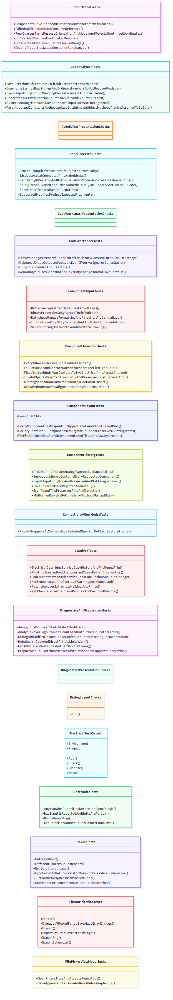](images/tests-tests-02.svg) · [PNG](images/tests-tests-02.png) |
| [tests-tests-03](generated/tests-tests-03.mmd) | Типов 20. FootprintRepositoryTests, GuidePresentationChecks, GuideTests, LayoutAssertions и другие. | [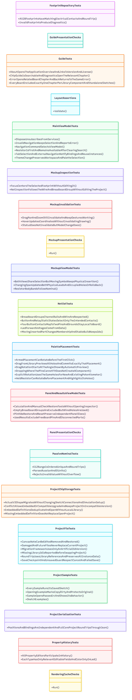](images/tests-tests-03.svg) · [PNG](images/tests-tests-03.png) |
| [tests-tests-04](generated/tests-tests-04.mmd) | Типов 20. ResistanceTests, ResistorEditorTests, ResistorPresentationChecks, SceneBuilderTests и другие. | [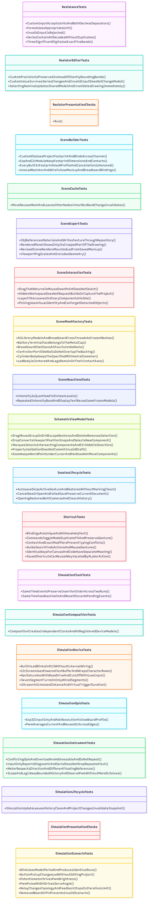](images/tests-tests-04.svg) · [PNG](images/tests-tests-04.png) |
| [tests-tests-05](generated/tests-tests-05.mmd) | Типов 20. SimulationStorageTests, SketchExecutionTests, SketchLaunchTests, SketchMultiplePeripheralsTests и другие. | [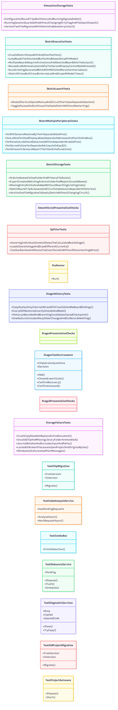](images/tests-tests-05.svg) · [PNG](images/tests-tests-05.png) |
| [tests-tests-06](generated/tests-tests-06.mmd) | Типов 13. TestProjectFactory, TestShortcutSettingsRepository, TestSimulationPulse, TestTextMeasurer и другие. | [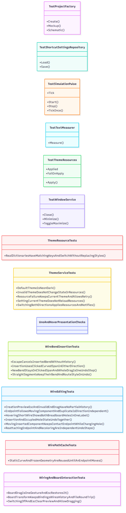](images/tests-tests-06.svg) · [PNG](images/tests-tests-06.png) |
| [views-viewmodels-app-01](generated/views-viewmodels-app-01.mmd) | Типов 20. ActuatorBodyDrawing, AnalysisDrawing, ArduinoNanoDrawing, ArduinoUnoDrawing и другие. | [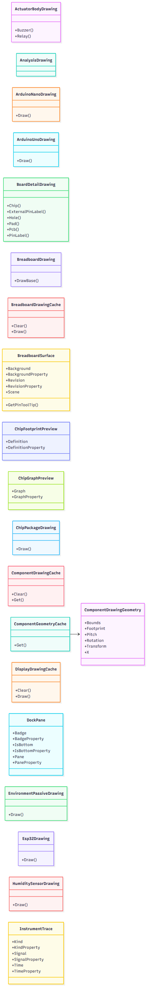](images/views-viewmodels-app-01.svg) · [PNG](images/views-viewmodels-app-01.png) |
| [views-viewmodels-app-02](generated/views-viewmodels-app-02.mmd) | Типов 20. Lcd1602Drawing, LedDrawing, MiscComponentDrawing, NetInspectionDrawing и другие. | [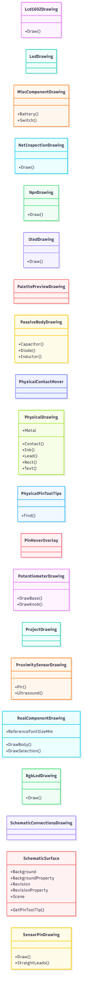](images/views-viewmodels-app-02.svg) · [PNG](images/views-viewmodels-app-02.png) |
| [views-viewmodels-app-03](generated/views-viewmodels-app-03.mmd) | Типов 20. ServoDrawing, SevenSegmentDrawing, SimulationDrawing, SplitterDrawing и другие. | [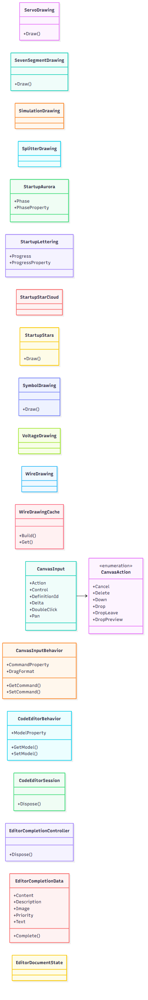](images/views-viewmodels-app-03.svg) · [PNG](images/views-viewmodels-app-03.png) |
| [views-viewmodels-app-04](generated/views-viewmodels-app-04.mmd) | Типов 20. EditorFoldingController, EditorHighlighting, EditorLineCommands, EditorSearchController и другие. | [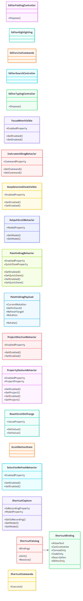](images/views-viewmodels-app-04.svg) · [PNG](images/views-viewmodels-app-04.png) |
| [views-viewmodels-app-05](generated/views-viewmodels-app-05.mmd) | Типов 20. ShortcutHintExtension, SmoothScrollBehavior, BoardInteractionViewModel, BreadboardViewModel и другие. | [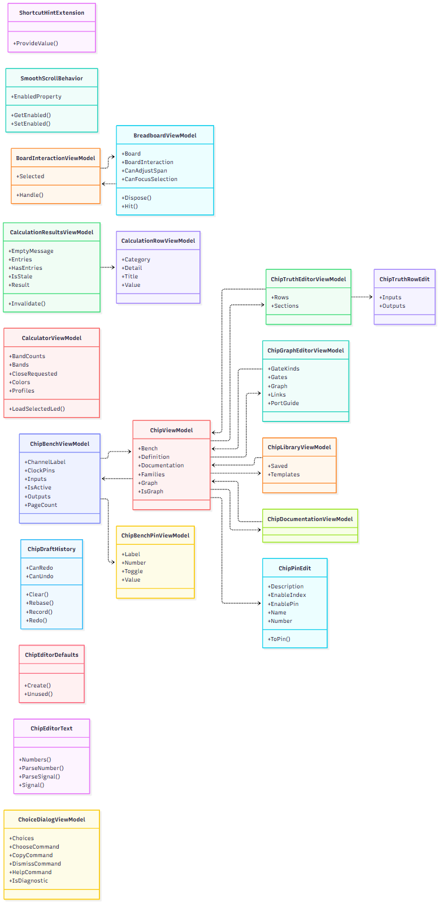](images/views-viewmodels-app-05.svg) · [PNG](images/views-viewmodels-app-05.png) |
| [views-viewmodels-app-06](generated/views-viewmodels-app-06.mmd) | Типов 20. CodeProblemViewModel, CodeProblemsViewModel, CodeViewModel, ComponentInputViewModel и другие. | [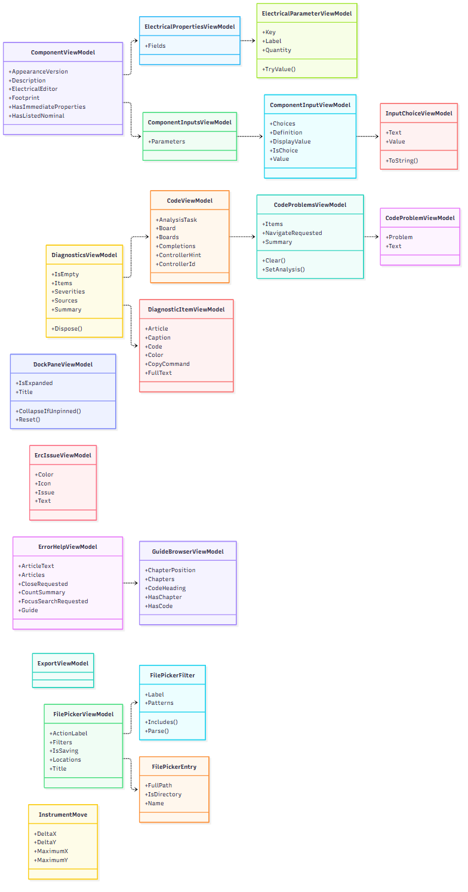](images/views-viewmodels-app-06.svg) · [PNG](images/views-viewmodels-app-06.png) |
| [views-viewmodels-app-07](generated/views-viewmodels-app-07.mmd) | Типов 20. InstrumentViewModel, MainViewModel, MockupSimulationInput, OutputViewModel и другие. | [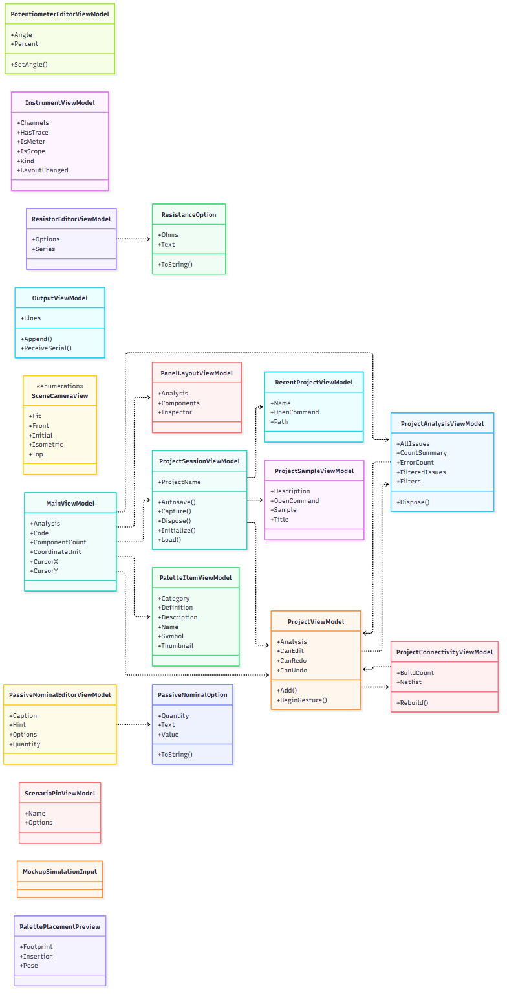](images/views-viewmodels-app-07.svg) · [PNG](images/views-viewmodels-app-07.png) |
| [views-viewmodels-app-08](generated/views-viewmodels-app-08.mmd) | Типов 20. SchematicViewModel, ShortcutGuideViewModel, SimulationControllerViewModel, SimulationInstrumentsViewModel и другие. | [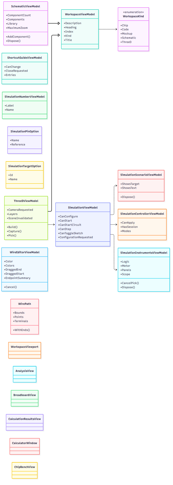](images/views-viewmodels-app-08.svg) · [PNG](images/views-viewmodels-app-08.png) |
| [views-viewmodels-app-09](generated/views-viewmodels-app-09.mmd) | Типов 20. ChipGraphView, ChipLibraryView, ChipTruthView, ChipView и другие. | [](images/views-viewmodels-app-09.svg) · [PNG](images/views-viewmodels-app-09.png) |
| [views-viewmodels-app-10](generated/views-viewmodels-app-10.mmd) | Типов 8. ResistorPropertiesView, SchematicView, ShortcutGuideWindow, SimulationInspectorView и другие. | [](images/views-viewmodels-app-10.svg) · [PNG](images/views-viewmodels-app-10.png) |

## Проверка и регенерация

Из корня репозитория:

```powershell
dotnet run --project tools/UmlGenerator -- .
dotnet run --project tools/UmlGenerator -- . --check
```

Режим --check сообщает о несовпадении и возвращает 1, если исходники и автогенерированные .mmd расходятся.

Для экспорта нужен Node.js и браузер, который устанавливает Mermaid CLI. Следующий проход проверяет синтаксис и создаёт оба формата:

```powershell
$inputFiles = Get-ChildItem docs/uml -Recurse -Filter *.mmd
foreach ($file in $inputFiles) {
    foreach ($ext in 'svg', 'png') {
        npx --yes @mermaid-js/mermaid-cli@12.2.0 -q -i $file.FullName -o "docs/uml/images/$($file.BaseName).$ext"
        if ($LASTEXITCODE -ne 0) { throw "Ошибка Mermaid в $($file.Name)" }
    }
}
```
